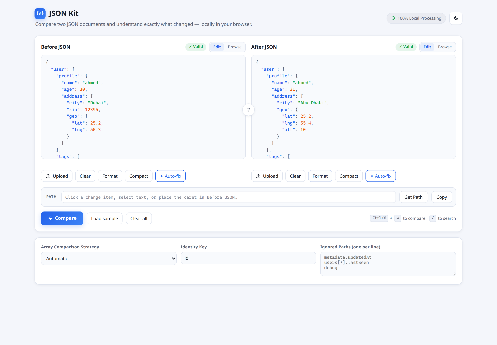
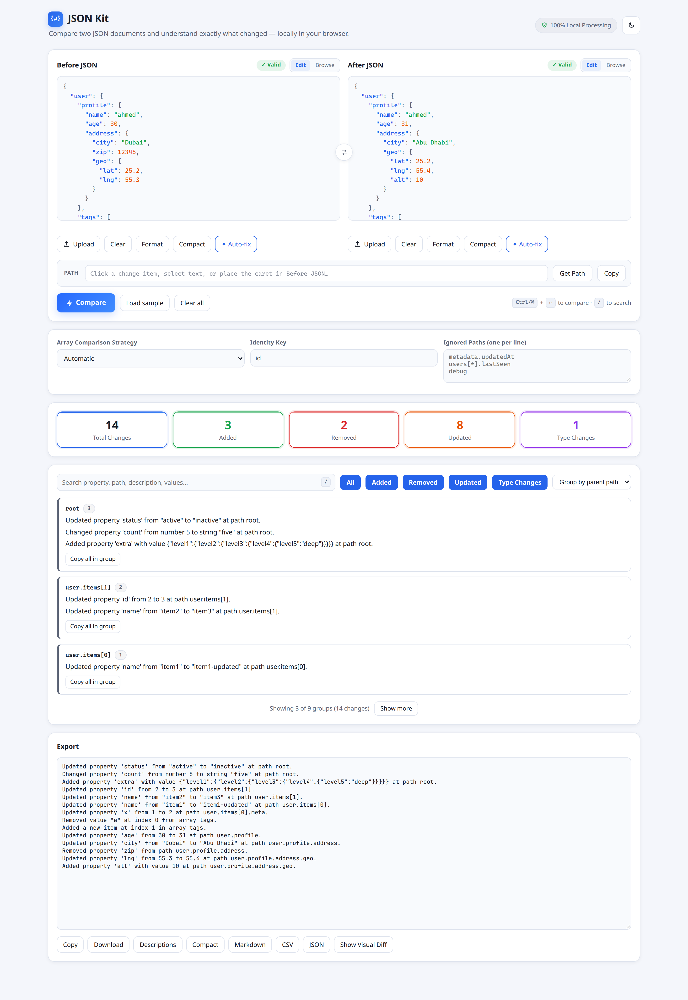
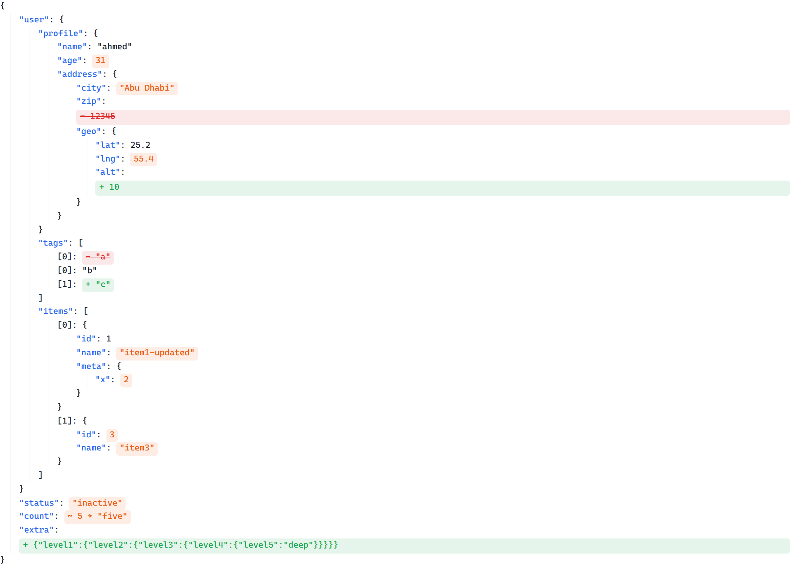
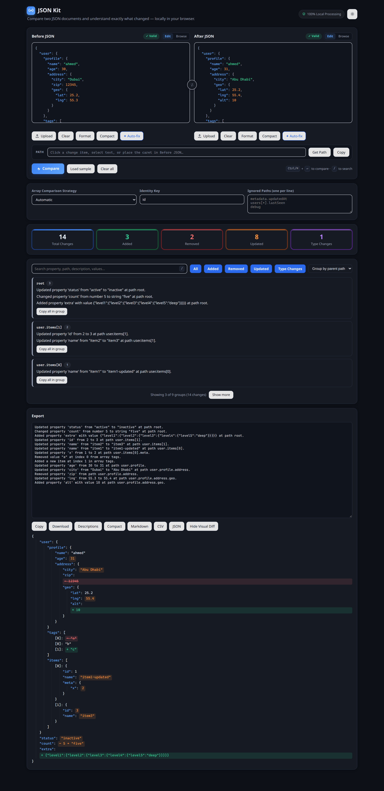
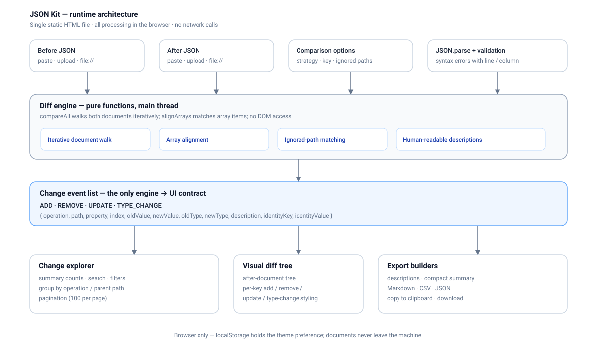

# JSON Kit

Compare two JSON documents and get a human-readable explanation of every change — plus search, filtering, a visual diff tree, and exports.

**Live demo: [mo3ta.top/json-kit](https://mo3ta.top/json-kit/)**

Everything runs locally in your browser. There is no backend, no account, no upload, and no telemetry. The page is static: `index.html` plus `core/json-kit.js`, with zero runtime dependencies and no build step.

## Screenshots

| Input | Results |
| --- | --- |
|  |  |

| Visual diff | Dark theme |
| --- | --- |
|  |  |

## Features

- **Side-by-side editors** — paste JSON or upload `.json` files; format, compact, clear, or swap the two sides. Both editors get live syntax highlighting and a validity pill (✓ Valid / ✕ Invalid) as you type.
- **Browse mode** — switch either editor between Edit and Browse to see that document as a collapsible tree. Every object and array gets a chevron anchor, Expand all / Collapse all reduce the document to an outline, and **Collapse around selection** keeps only the path to the selected node open while folding shallower siblings and deeper levels.
- **Auto-fix** — per-editor “✦ Auto-fix” button repairs common JSON mistakes in place: smart/guillemet quotes (`“age”: 25`), single quotes, missing or trailing commas, unquoted keys/values, `//` and `/* */` comments, `NaN`/`Infinity`, control characters, and unclosed braces/brackets. A report lists what was changed, or confirms the input was already valid.
- **Get Path** — place the cursor in either editor to extract the JSON path at that position and copy it.
- **Structured diff** — reports `ADD`, `REMOVE`, `UPDATE`, and `TYPE_CHANGE` events with old and new values and types.
- **Array strategies** — compare arrays by index, by an identity key (default `id`), or automatically.
- **Ignored paths** — skip noisy fields with one path per line, including wildcards such as `users[*].lastSeen`.
- **Human-readable descriptions** — every change is explained in a sentence, not just rendered as a JSON Patch.
- **Old/new value chips** — each change shows the before and after values side by side (click a chip to copy its value).
- **Search and filter** — full-text search (`/` to focus, `Esc` to clear), operation filters, and grouping by operation or parent path.
- **Clickable summary cards** — the counts double as filters; click "Added" to see only additions.
- **Keyboard shortcuts** — `Ctrl/⌘`+`Enter` runs a comparison with whatever is in the editors.
- **Visual diff tree** — a color-coded tree of the resulting document showing exactly what was added, removed, or updated.
- **Exports** — plain-text descriptions, compact summaries, Markdown, CSV, or JSON; copy or download from the browser.
- **Light and dark themes** — theme follows the system by default and persists in `localStorage`.
- **Private by design** — all parsing and comparison happens client-side.

## Quick start

```bash
git clone https://github.com/MahmoudMabrok/json-kit.git
cd json-kit
open index.html
```

That's it — no install, no build. The page also works when opened directly via `file://`.

If you prefer a local server:

```bash
python3 -m http.server 8000
# then open http://localhost:8000
```

## How it works

1. Both editors are parsed with `JSON.parse`. Invalid input is reported with line and column.
2. The diff engine walks both documents and emits an event for each difference.
3. The UI derives summary counts, filters, groups, renders the change list, and builds the visual tree from those events.
4. Export builders transform the same event list into Markdown, CSV, JSON, or plain text.

### Array comparison

| Strategy | Behavior |
| --- | --- |
| `Automatic` (default) | Uses identity matching for items that are objects containing the identity key, then aligns the remaining items with a longest-common-subsequence pass over stable value signatures. Falls back to index alignment for very large arrays. |
| `Index-based` | Pairs items by position; extra items are reported as added or removed. |
| `Identity-based` | Pairs object items by the identity key (default `id`), even when their positions change; items without the key fall back to value-based alignment. |

### Ignored paths

Patterns use dotted keys and `[*]` for any array index:

```
metadata.updatedAt
users[*].lastSeen
debug
```

Paths are matched on the parsed path segments, so array positions do not need to be known in advance.

## Architecture



The interface stays in one file. The pure logic is a second file both the page and the MCP server load, with no build:

- **Core** (`core/json-kit.js`) — pure functions (`compareAll`, `fixJson`, `parseJson`, path lookup, export builders, visual tree). No DOM. The page loads it with `<script src="core/json-kit.js"></script>`, a classic script so the relative URL resolves under `/json-kit/` on GitHub Pages and the file still opens via `file://`. Comparison runs on the main thread.
- **Event model** — the only contract between engine and UI: `{ operation, path, property, index, oldValue, newValue, oldType, newType, description, ... }`.
- **Presentation** (`index.html`) — editors, summary, filtering/grouping, visual tree, and export buttons, all derived from the event list.

```text
index.html                 # app: styles and UI
core/json-kit.js           # shared pure logic (page + MCP server)
mcp/                       # MCP server (stdio) and its tests
docs/screenshots/          # images used in this README
docs/adr/                  # architecture decision records
```

Key implementation choices are documented as ADRs:

- [ADR 0001 — Ship as a single static HTML file](docs/adr/0001-single-static-file.md)
- [ADR 0002 — Emit a flat event list instead of a patch](docs/adr/0002-event-based-diff-model.md)
- [ADR 0003 — Multiple array alignment strategies](docs/adr/0003-array-alignment.md)
- [ADR 0004 — Serve from GitHub Pages without a build](docs/adr/0004-github-pages-hosting.md)

### Limits

- Values are compared with strict equality after parsing, so `1` and `1.0` are equal, while key order is ignored for objects but significant for arrays unless an identity strategy is used.
- The visual tree is a rendering of the *after* document annotated with changes; deeply nested additions may be summarized at their parent.
- Very large documents are processed on the main thread. The UI shows a progress overlay while comparing.

## Deployment

GitHub Pages serves this repository from the `main` branch root. There is no Actions workflow and no build. The user site [`MahmoudMabrok/mahmoudmabrok.github.io`](https://github.com/MahmoudMabrok/mahmoudmabrok.github.io) has a CNAME of `mo3ta.top`, so this project site is published at:

**https://mo3ta.top/json-kit/**

Styles and the icon are inline (the icon is a data URI). The only extra request is the relative script `core/json-kit.js` — no leading slash, no `<base>` tag — so it resolves to `/json-kit/core/json-kit.js` on GitHub Pages, to `/core/json-kit.js` on a local server, and beside `index.html` when opened via `file://`. Do not add a `CNAME` file in this repo — the custom domain belongs to the user site. There is no client-side router, so refreshing `/json-kit/` does not need a `404.html` fallback.

1. Push to `main`.
2. In **Settings → Pages**, keep the source as **Deploy from a branch** → `main` → `/ (root)`.
3. The site is published at `https://mo3ta.top/json-kit/`.

## MCP server

JSON Kit's comparison, explanations, formatting, validation, auto-fix, path lookup, browse outline, exports, and visual diff are also tools for MCP clients (Claude Desktop, Cursor, Claude Code). The server is `mcp/`, package name `json-kit-mcp`. It speaks stdio and calls `core/json-kit.js` — the same file the page loads. It is not published to npm from this repo; see [mcp/README.md](mcp/README.md) for tool list, local run, and copy-paste client config.

```bash
cd mcp
npm install
npm test
node src/cli.js
```

A later remote transport (Streamable HTTP, for example on Cloudflare Workers at a subdomain of mo3ta.top) could wrap these same tool handlers. That is not built here.

## Contributing

Issues and pull requests are welcome at [MahmoudMabrok/json-kit](https://github.com/MahmoudMabrok/json-kit). Open `index.html` and compare a few JSON pairs in both themes after a UI change. `npm test` (from the repo root, after `npm install` inside `mcp/`) runs the core and MCP tests.
